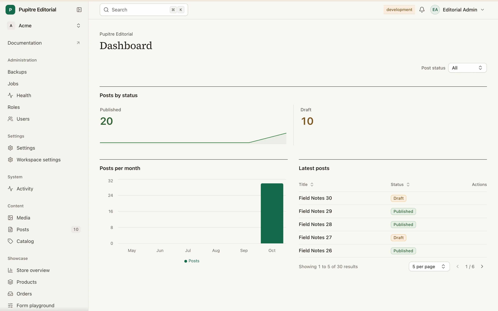

<p align="center">
  
</p>

<h1 align="center">Pupitre</h1>

<p align="center">
  Filament-class admin panels for <strong>AdonisJS v7</strong> and <strong>Inertia React</strong>.<br>
  <a href="https://pupitre.rikology.com">Documentation</a> ·
  <a href="https://pupitre.rikology.com/getting-started/">Getting started</a> ·
  <a href="https://pupitre.rikology.com/migrating-from-filament/">Coming from Filament</a>
</p>

Pupitre is a Filament-inspired admin framework for **AdonisJS v7 and Inertia React**. Describe Lucid resources, reactive forms, tables and server-authorized actions with typed TypeScript builders; Pupitre handles routes, VineJS validation and scoped queries while you keep ownership of your React components. Optional plugins add roles and permissions, audit activity, realtime updates, media, calendars, kanban boards, job monitoring, health checks and backups.



## Requirements

- Node.js **24+**
- An AdonisJS **v7** application with **Inertia React**, Lucid, a configured database and session authentication
- Host models, migrations and Bouncer policies for the resources you expose

## Quick start

Inside your AdonisJS application:

```sh
node ace add @rikology/pupitre
node ace make:resource Post
```

The installer registers Pupitre and publishes the starter panel, frontend registry and host migrations. **Review the generated migrations against your existing user schema before running `node ace migration:run`.**

For an existing `Post` model and `PostPolicy`, define `app/admin/resources/post_resource.ts`:

```ts
import { defineResource, table, actions } from '@rikology/pupitre'
import Post from '#models/post'
import PostPolicy from '#policies/post_policy'

export default defineResource(Post)
  .policy(PostPolicy)
  .recordTitle('title')
  .form((s) => [s.text('title').required().maxLength(200)])
  .table((t) => t.columns([table.text('title').searchable().sortable()]))
  .actions({ row: [actions.edit(), actions.delete()] })
```

Register the resource in your panel, configure the host auth model, then start `node ace serve --hmr`. See the [getting-started guide](https://pupitre.rikology.com/getting-started/) for the complete panel and authentication setup. A resource without a policy allows access and logs a warning: define your authorization before exposing it.

Opt in to fail-closed policy coverage with `definePanel('admin').strictAuthorization()`: missing resource, nested-resource and relation-manager model policies abort boot with `E_PUPITRE_MISSING_POLICY`; policy-less related-model authorization also denies at runtime. `node ace pupitre:inspect --json` reports strict mode and violations.

## Packages

| Package | Role |
| --- | --- |
| [@rikology/pupitre](packages/pupitre) | Server builders, compiler, routes, queries and optional adapters |
| [@rikology/pupitre-react](packages/pupitre-react) | React runtime and Inertia action transport |
| [@rikology/pupitre-ui](packages/pupitre-ui) | Default Base UI components and copyable shadcn registry |
| [@rikology/pupitre-shield](packages/pupitre-shield) | Database-backed roles, permissions and Bouncer integration |
| [@rikology/pupitre-audit](packages/pupitre-audit) | Read-only activity and record history backed by audit-trail |
| [@rikology/pupitre-settings](packages/pupitre-settings) | Typed grouped settings, transactional saves and tenant-isolated pages |
| [@rikology/pupitre-transmit](packages/pupitre-transmit) | Authenticated AdonisJS Transmit realtime integration |
| [@rikology/pupitre-media](packages/pupitre-media) | Media library, reusable media picker field and image conversions |
| [@rikology/pupitre-calendar](packages/pupitre-calendar) | Calendar widgets and pages with authorized drag rescheduling |
| [@rikology/pupitre-kanban](packages/pupitre-kanban) | Kanban boards for resources with authorized status moves |
| [@rikology/pupitre-jobs](packages/pupitre-jobs) | Queue job monitor with failure inspection and retries |
| [@rikology/pupitre-health](packages/pupitre-health) | Application health check dashboard |
| [@rikology/pupitre-backup](packages/pupitre-backup) | Database backups with retention and private downloads |
| [@rikology/create-pupitre-plugin](packages/create-pupitre-plugin) | Publishable plugin scaffolder |

## Documentation and contributing

- [Documentation — pupitre.rikology.com](https://pupitre.rikology.com)
- [Development, setup and contributing](docs/DEVELOPMENT.md)
- [Testing strategy](docs/TESTING.md)
- [Example AdonisJS application](apps/example)
- [Security policy and vulnerability reporting](SECURITY.md)

## License

MIT, as declared in the published [package metadata](packages/pupitre/package.json).
