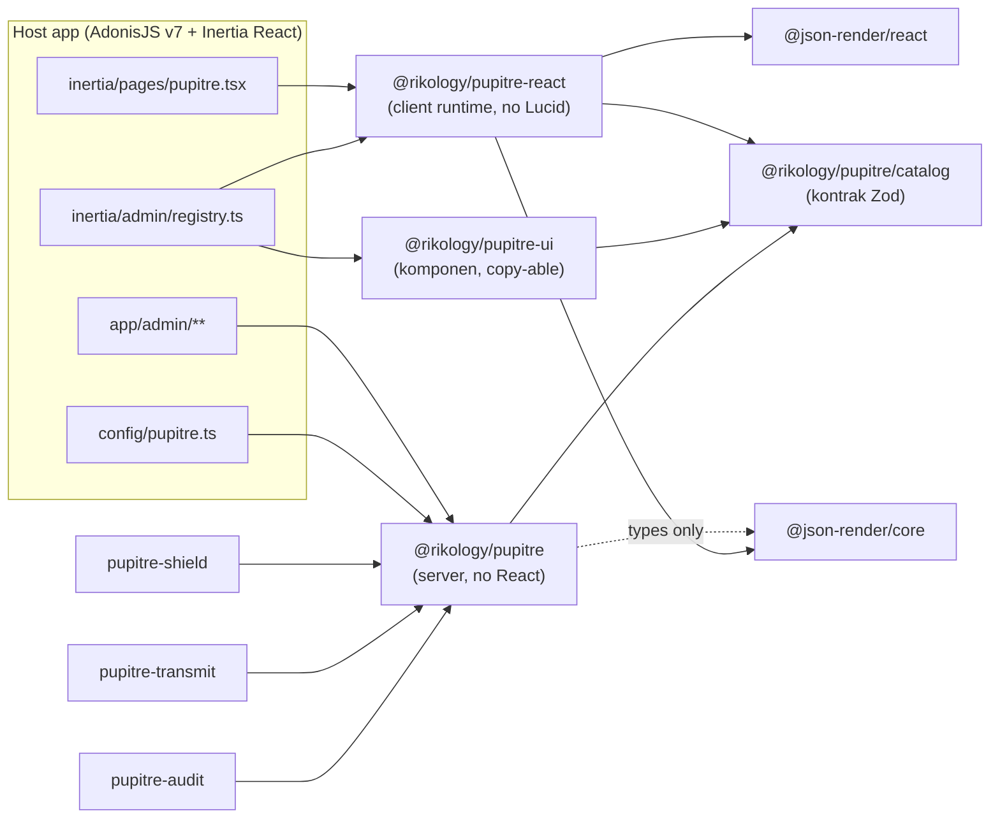
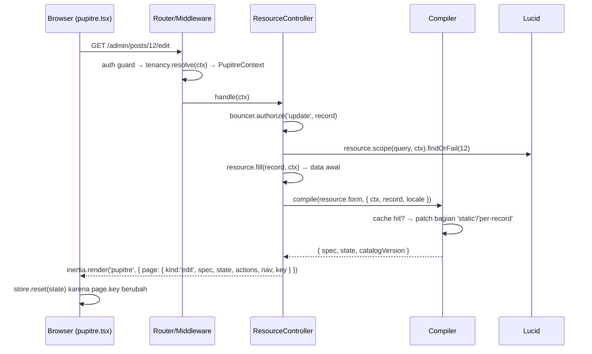

# Pupitre — Arsitektur

Turunan dari [DESIGN.md](./DESIGN.md). Dokumen ini menjelaskan *bagaimana* keputusan desain diwujudkan dalam kode: batas package, modul internal, alur request, dan invarian yang tidak boleh dilanggar.

## 1. Batas package



| Package | Boleh import | Tidak boleh import |
| --- | --- | --- |
| `pupitre` | `@adonisjs/*`, `@vinejs/vine`, `luxon`, `@json-render/core` (hanya `type`) | `react`, `@inertiajs/react`, apa pun dari `pupitre-react`/`pupitre-ui` |
| `pupitre/catalog` | `zod` saja | Semua yang lain (dipakai server + client + renderer non-React) |
| `pupitre-react` | `react`, `@inertiajs/react`, `@json-render/core`, `@json-render/react`, `zustand`, `pupitre/catalog` | `@adonisjs/*`, `lucid`, JSX komponen visual |
| `pupitre-ui` | `react`, `@base-ui/react`, `@tanstack/react-table`, `recharts`, `pupitre/catalog`, hooks dari `pupitre-react` | `@json-render/*` langsung (lewat hooks `pupitre-react`), server code |
| Plugin resmi | `pupitre` + peer-nya sendiri | `pupitre-react` (plugin menyumbang spec, bukan komponen; komponen tambahan lewat registry host) |
| `pupitre-transmit/client` | `@adonisjs/transmit-client`, type dari `pupitre/catalog` | server Adonis, `pupitre-react`, `pupitre-ui` |

Batas ini ditegakkan oleh lint rule `no-restricted-imports` per workspace dan oleh `verify:exports` di CI (lihat [DEVELOPMENT.md](./DEVELOPMENT.md)).

Distribusi copy-ownership WP40: `tools/registry-build` memindai sumber `pupitre-ui` dan graph import. Manifest committed: `packages/pupitre-ui/registry/registry.json`; payload dengan `content`: `registry/public/r/<name>.json`, disajikan docs site sebagai `https://pupitre.dev/r/<name>.json` bersama index `/registry.json`. Dependency registry memakai URL absolut; runtime/core catalog tetap npm. Target `components/pupitre/<path relatif sumber>` menjaga import relatif; host mengimpor stylesheet sesudah Tailwind. CI `registry:check` mencegah drift sumber/JSON dan menguji semua import setelah salinan hanya dari JSON.

## 2. Modul internal `@rikology/pupitre`

```
packages/pupitre/
  index.ts                     # definePanel, defineResource, definePage, defineWidget,
                               # defineRelationManager, schema, table, action(s), nav, stubsRoot, configure
  configure.ts                 # node ace add → stubs, migrasi, adonisrc hook, middleware
  providers/pupitre_provider.ts
  services/main.ts             # singleton PupitreManager
  commands/                    # pupitre:install, make:*, pupitre:inspect, pupitre:routes, pupitre:ui
  stubs/
  src/
    builder/                   # DSL murni: menghasilkan "definition" (plain object + closures)
      panel.ts  resource.ts  pages.ts (resource page builder)  page.ts (custom page)  widget.ts  relation_manager.ts
      schema/   table/   action.ts   nav.ts
    definition/                # tipe hasil builder (ResourceDefinition, FieldDefinition, ...)
    compiler/
      schema_compiler.ts       # FieldDefinition[] → Spec elements + initial state
      table_compiler.ts        # TableDefinition → TableDescriptor
      action_compiler.ts       # ActionDefinition → ActionDescriptor (per record)
      closure_lifter.ts        # closure → $cond/$template/$state, atau 'static'/'server'
      vine_compiler.ts         # FieldDefinition[] → vine.compile(schema)
      cache.ts                 # key panel:resource:page:locale:hash
    http/
      router.ts                # registrasi route group per panel, nama route
      middleware/              # pupitre_context, tenancy_resolver, share_props
      controllers/             # resource_controller, action_controller, custom_page_controller, internal_controller, auth/*
      page_props.ts            # merakit props `page` untuk Inertia
    pages/                     # custom page routes, owner resolver untuk form/options/upload
    query/
      table_query.ts           # URL query → Lucid query (sort/search/filter/group/paginate)
      search.ts                # global search
      options.ts               # opsi dinamis + relationship search
    authz/bouncer.ts           # pemetaan aksi panel → ability
    tenancy/                   # TenancyAdapter + driver default (kolom tenant_id)
    adapters/                  # interface: jobs, realtime, storage, mail, cache, tenancy, notifications, audit
    drivers/                   # implementasi atas optional peers (subpath export)
    auth/                      # login, register, reset, profile, mfa (totp), passkeys, social
    discovery/index_admin.ts   # hook adonisrc indexAdmin
    testing/                   # subpath @rikology/pupitre/testing
  catalog/                     # subpath @rikology/pupitre/catalog (Zod, tanpa dependency lain)
```

Aturan lapisan di dalam core, dari bawah ke atas: `catalog` → `definition` → `builder` → `compiler` → `query`/`authz`/`tenancy` → `http`. Lapisan bawah tidak boleh import lapisan atas. `builder` tidak boleh menyentuh `HttpContext`; semua yang butuh request terjadi di `compiler` (saat `compile(definition, ctx)`) atau `http`.

## 3. Modul internal `@rikology/pupitre-react`

```
packages/pupitre-react/src/
  page/Pupitre.tsx             # satu page Inertia; switch pada page.kind
  shell/                       # Sidebar, Topbar, TenantSwitcher, GlobalSearch, NotificationTray, Breadcrumb (dari registry)
  renderer/
    PupitreRenderer.tsx        # <StateProvider store> + <ActionProvider> + <Renderer>
    store.ts                   # Zustand store + createStoreAdapter (@json-render/core/store-utils)
    functions.ts               # $computed functions bawaan (format tanggal, angka, template)
  bridge/
    actions.ts                 # visit, reload, submitForm, openAction, runAction, evaluate, fetchOptions, upload
    inertia.ts                 # wrapper router Inertia v3: only, preserveState, deferred
    errors.ts                  # 422 → /errors/**
  hooks/                       # useField(name), useAction(name), useTable(descriptor), usePanel()
  registry/defineRegistry.ts   # wrapper defineRegistry json-render dengan catalog Pupitre
```

## 4. Alur request

### 4.1 GET halaman resource (list/create/edit/view)



### 4.2 Submit form

```mermaid
sequenceDiagram
  participant B as Browser
  participant C as ResourceController
  participant V as VineJS (compiled)
  participant L as Lucid

  B->>C: PUT /admin/posts/12 { data }
  C->>C: authorize('update')
  C->>V: validator.validate(data)
  alt invalid
    C-->>B: 422 → Inertia errors { 'items.0.sku': '...' }
    B->>B: bridge.errors → set('/errors/items/0/sku'); /data tidak disentuh
  else valid
    C->>L: trx.begin()
    C->>C: mutateBeforeSave → beforeSave → record.merge().save() → afterSave
    C->>L: trx.commit()
    C-->>B: redirect (flash) → props baru untuk page yang sama
  end
```

### 4.3 Action berbentuk form (modal)

1. Spec halaman membawa `ActionDescriptor { name, kind:'form', url, label, icon, color, enabled }`.
2. Klik → `useRunAction()` → `GET url` (`Accept: application/json`) → `ActionFormResponse { spec, state }` → `ActionModal` dirender oleh `PupitreRenderer` kedua dengan store terpisah.
3. Submit → `fetch(url, { data, ids? })` JSON dengan `X-Pupitre-Action: 1` → `ActionResult { flash, redirect?, reload?, patch?, deselect? }` / 422 / 403 (ADR-0012, WIRE_PROTOCOL §4).

### 4.4 Tabel

URL query adalah satu-satunya sumber state tabel. `useTable` → `router.reload({ only: ['data'], data: query })` → `ResourceController.list` membangun ulang query Lucid dari URL → mengembalikan prop top-level `data: { rows, meta, query }` (ADR-0011). Spec/descriptor tabel tidak ikut dikirim ulang.

## 5. Compiler

### 5.1 Input/output

```ts
compileForm(nodes: SchemaNodeDefinition[], options: CompileContext & { form: FormDescriptor; data? }): Promise<CompiledSchema>
compileInfolist(nodes: SchemaNodeDefinition[], options: CompileContext): Promise<CompiledSchema>
// CompileContext = { locale, timezone, ctx?, record?, model?, uploadUrls?, resolveFileUrl?, cache? }
// CompiledSchema = { spec: Spec, state: StateModel, catalogVersion: string }
```

### 5.2 Cache

- Key: `${panel}:${resource}:${page}:${locale}:${hash}` di mana `hash` = SHA-1 dari `definition.toJSON()` (closure di-hash dari `Function.prototype.toString()`).
- Nilai: spec + daftar *slot* yang bergantung record/ctx (`static` dari closure lifter, `fillForm`, `visible`/`can` per action).
- Per request: ambil dari cache → evaluasi slot → `applySpecStreamPatch` untuk menambal. Tidak pernah memutasi objek cache.
- Dimatikan saat `NODE_ENV=development` kalau `config.pupitre.cache.dev === false` (default) supaya edit resource langsung terlihat.

### 5.3 Closure lifting

Lihat [DESIGN.md §Compiler](./DESIGN.md#compiler-builder--spec-json-render). Keputusan tambahan:

| Hasil lift | Dipakai untuk | Cara kerja |
| --- | --- | --- |
| `expression` | `visible`, `disabled`, `label`, `helperText`, `placeholder.content` | `acorn` mem-parse `fn.toString()`; pola sederhana diterjemahkan: `get('status') === 'published'` → `{ $state: '/data/status', eq: 'published' }`, `!==`/`>`/`<`/`!`/truthiness, `&&` → `$and`, `\|\|` → `$or`, template string → `$template`, ternary → `$cond`; di dalam repeater `get('qty')` → `{ $item: 'qty' }` |
| `static` | sama | Dievaluasi per request di server dengan state awal + record; hasil literal di-patch ke salinan spec cache |
| `server` | `afterStateUpdated` | `.live({ server: true })` menurunkan closure apa pun menjadi `watch` + aksi `evaluate`; endpoint mengotorisasi `create`/`update`, memakai query terscope tenant untuk record edit, lalu hanya mengembalikan pointer `/data/**` ke field yang ada serta tidak hidden/disabled |
| `computed` | `placeholder.content` aritmatika sederhana | `{ $computed: 'expr', args }` dengan **fungsi terdaftar** bawaan (`add`, `mul`, `concat`, `formatNumber`, ...), **bukan** string JS yang di-`eval` |

Keputusan: desain v0 menyebut "fungsi dikirim sebagai string di spec". Itu **tidak** dilakukan: `new Function` di client bentrok dengan CSP Shield (`script-src` tanpa `unsafe-eval`) dan membuka celah kalau spec pernah berasal dari sumber lain. Closure yang tidak bisa dipetakan ke fungsi `$computed` terdaftar jatuh ke `static` atau `server`. Lihat [ADR-0002](./adr/0002-client-first-reactivity.md).
Closure `afterStateUpdated` yang tidak dapat diangkat ke ekspresi client dan tidak memakai `live({ server: true })` tetap ditolak dengan `E_PUPITRE_UNLIFTABLE_CLOSURE`, yang menyarankan opsi server tersebut. Evaluasi berlaku pada form resource create/edit dan custom page; form action modal memakai store modal terpisah dan tidak menjadi form owner untuk endpoint ini.

## 6. Otorisasi dan tenancy di jalur request

Urutan middleware group panel (dipasang oleh `router.ts`):

1. Middleware host dari `.middleware([...])` — referensi middleware asli (`middleware.auth({ guards: ['web'] })` dari `#start/kernel`), bukan string, karena package tidak bisa mengimpor koleksi named middleware host.
2. `pupitre_context`: membangun `ctx.pupitre = { panel, locale, timezone, user }`.
3. `tenancy_resolver`: resolves the configured `TenancyAdapter`, confirms membership, sets `ctx.pupitre.tenant`, and request-binds the panel path in URL mode. The `@rikology/adonisjs-tenant` driver runs downstream work in `TenantService` context.
4. `share_props`: `inertia.share({ user, tenant, tenants, nav, flash, notifications })`. `nav` sudah difilter `viewAny`.

Adapter realtime opsional (`RealtimeAdapter`) memiliki `driver`, `publish(channel, event): Promise<void>` dan `initialize?(manager)`. Core memuat adapter saat boot, menyusun channel panel/user/resource/tenant, lalu menerbitkan ping setelah mutasi atau penyimpanan notifikasi. `transmitRealtime()` menyediakan transport SSE dan otorisasi subscription; host mendaftarkan provider, config serta route Transmit dengan middleware sesi. Client host membuat satu `transmitRealtimeClient()` dan memberikannya ke `<Pupitre realtime={client} />`; renderer bergantung pada interface catalog saja. Ping tidak membawa record dan tidak menggantikan query scoped/Bouncer pada reload.

Nama event wire adalah `pupitre:notification` dan `pupitre:table` tanpa alias lama. Ping inbox dikirim ke semua panel dengan notifications aktif. Transmit memakai helper core `panelGuard` dan `realtimeChannels.patterns`; pembentuk channel dan pola otorisasi mempunyai satu sumber format.

Controller selalu mengotorisasi ability tingkat resource sebelum query (`viewAny` untuk list, `create` untuk create, serta `viewAny` sebelum pencarian record); setelah record ditemukan lewat query terscope, ability record (`view`/`update`/`delete` atau custom action) diperiksa sebelum data dipakai atau dimutasi. Query selalu lewat `scopedQuery(ctx, resource)`: callback `.scope(fn)` berjalan terlebih dahulu, lalu default adapter scope; `.scope(false)` sengaja melewati tenancy untuk resource global. Ownership create diterapkan lagi setelah mutation hooks, sementara update menghapus kolom ownership dari data sebelum handler/merge agar record tidak dapat dipindahkan tenant. Policy relasi memakai policy model terkait (`viewAny`). Matriks test memeriksa semua route panel yang diklasifikasikan dan gagal bila ada route baru tanpa mapping.
Action field form (`prefixAction`, `suffixAction`, `hintAction`) tanpa record mengikuti ability halaman create: `create`, baik saat membuka form action maupun menjalankannya. Action yang ditemukan pada grup header/bulk resource tetap memakai `viewAny`, termasuk bila definition action yang sama juga dipasang pada field. Ability `.can()` action tetap diperiksa. Modal create/edit mengonsumsi upload form sebelum persistence, sama seperti store/update halaman penuh.

Lookup identifier route, input record upload, dan pilihan ID bulk memakai `lookupOrNull`: identifier integer/UUID PostgreSQL yang tidak valid (`22P02`) menjadi record tidak ditemukan (404), konsisten dengan SQLite. Error database lain tidak disembunyikan; helper hanya membungkus lookup identifier, bukan validasi atau persistence.
Pada relation manager, parent record diselesaikan lebih dulu melalui `scopedQuery` dan wajib lulus `view`; operasi mutasi juga mensyaratkan `update` parent. Related table menjalankan `viewAny` terhadap model terkait. Mutasi terkait memeriksa ability `create`/`update`/`delete`/`attach`/`detach`/`associate`/`dissociate`; fallback yang dipakai adalah `attach → create`, `detach → delete`, dan `associate|dissociate → update`. `.readOnly()` atau penolakan `update` parent menonaktifkan aksi mutasi. Query related selalu dibatasi oleh Lucid relation pada parent dan tenant scope related resource; pencarian related id di luar parent menghasilkan 404.

Callback predicate host (`.scope(fn)`, `table.query`, filter/tab kustom, dan relationship scope) memakai proxy builder utama: pemanggilan WHERE serta `has`/`doesntHave` dan varian OR/AND direkam berurutan lalu diterapkan pada nested WHERE sebagai grup AND terpisah. `withScopes`/`apply` serta `if`/`unless`/`match` menerima proxy yang sama. Karena itu OR tidak dapat melewati tenant, parent relation, pilihan ID, atau soft-delete; `orderBy`, `preload`, `join`, `select`, dan `withCount` tetap diterapkan pada builder utama. Untuk resource nested, scope host child mempunyai grup sendiri sebelum predicate parent ditambahkan sebagai AND wajib. Callback tidak boleh menghapus predicate keamanan (`clearWhere`) atau mengganti query dengan union. Helper tenancy related yang sama dipakai oleh relation manager, opsi select, validasi ID relationship, dan create option: resource terdaftar mengikuti scope resource, model tidak terdaftar dengan kolom ownership mengikuti adapter tenant, dan model tanpa kolom ownership tetap global.

## 7. Auth bawaan

Semua halaman auth adalah `definePage` internal dengan `kind: 'auth'` (tanpa shell). Mereka memakai guard panel dan tabel/kolom di [DATABASE.md](./DATABASE.md). Fitur yang menyentuh kriptografi:

| Fitur | Library | Penyimpanan |
| --- | --- | --- |
| TOTP | `otplib` + `qrcode` | `users.mfa_secret` dienkripsi `encryption` Adonis; recovery codes disimpan sebagai SHA-256 hash per kode |
| Passkeys | `@simplewebauthn/server` (lazy optional peer) | tabel `pupitre_passkeys` (credential id, public key, counter, transports, last use) |
| Reset password | token acak 32 byte, hash SHA-256 | tabel `pupitre_password_resets`, TTL 60 menit |
| Social | `@adonisjs/ally` host | kolom `users.provider`, `users.provider_id` opsional; kalau tidak ada, hanya mencocokkan email |
Social login dibatasi provider lewat `panel.social`; route redirect/callback hanya dibuat untuk panel login yang aktif. Callback menolak denial/state mismatch/provider error, mencari identitas provider sebelum fallback ke email terverifikasi, dan selalu menyerahkan autentikasi ke `completeLogin` agar MFA tetap berlaku. Target redirect aman disimpan di session saat alur dimulai; callback query tidak diteruskan. Peer Ally dimuat secara lazy di `drivers/ally`.
`completeLogin` membuat challenge hanya pada panel dengan `.mfa()` aktif. Marker pending menyimpan penghitung percobaan per login; setelah lima kegagalan marker dibuang dan user harus login ulang. Limiter memakai kunci user, sementara penghitung session tetap membatasi percobaan meskipun limiter optional tidak terpasang. Passkey hanya melewati challenge MFA bila assertion juga menyatakan user verification berhasil; UV yang tidak ada melanjutkan ke challenge.

## 8. Invarian

- Server tidak pernah mempercayai `spec` dari client. Spec hanya mengalir server → client. Body `POST` divalidasi VineJS dari definition, bukan dari spec.
- Client tidak pernah memegang logika otorisasi: `visible`/`can` action sudah dievaluasi di server; client hanya menyembunyikan tombol dan server tetap menolak 403.
- `/data` di store hanya diubah oleh user atau `set()` dari handler; reload props Inertia memperbarui `/meta/record`, `/errors`, `/options` saja.
- `page.key` berubah ⇔ store di-reset. Key = `${panel}:${resource}:${page}:${recordId ?? ''}:${tenant ?? ''}`.
- Semua `dateTime` disimpan UTC, dikirim ke client sebagai ISO 8601 ber-offset, dan ditampilkan menurut prioritas komponen > timezone user > panel > `config/app.ts`.
- `dateTime` awal dikirim sebagai ISO ber-offset pada zona efektif. Input lokal tanpa offset diparse di zona field; ISO ber-offset mempertahankan instant yang dinyatakan oleh offset. Jam lokal yang tidak ada saat DST maju ditolak; jam ambigu saat DST mundur memilih offset lebih awal. `date` tetap kalender tanpa pergeseran. `time` hanya menyimpan jam dinding (`HH:mm[:ss]`) tanpa tanggal/offset, sehingga zona menjadi konteks tampilan dan tidak mengubah nilai tersimpan.

## 9. Plugin (WP36)

`definePlugin({ name, register, resources, pages, widgets, middleware, navigation, extendResource, boot })` mendefinisikan kontribusi server; plugin tidak memasang komponen React atau menyuntikkan renderer. Nama wajib kebab-case dan unik dalam `.plugins([...])`.

- Manager menerapkan plugin sesuai urutan deklarasi segera setelah panel dimuat. `register(panel)` menerima builder immutable dan boleh mengembalikan builder baru atau `void`; id panel tidak boleh berubah dan hook tidak boleh menambahkan plugin lain.
- Kontribusi resource/page/widget ditambahkan setelah milik panel. Middleware plugin berjalan setelah middleware panel.
- `extendResource(resource, { panel, parent? })` berjalan berurutan untuk semua resource, termasuk nested resource; boleh mengembalikan definition baru tetapi tidak boleh mengganti slug atau model.
- Semua panel diselesaikan terlebih dahulu. Setelah adapter jobs diinisialisasi, `boot({ app, manager, panel })` dipanggil sesuai urutan plugin, sebelum route didaftarkan.
- Navigasi eksplisit menggabungkan grup host dan plugin dengan label sama. Dalam mode derived, kontribusi navigasi plugin mengikuti grup derived; resource/page yang sudah dirujuk plugin tidak diturunkan lagi agar tidak duplikat.

`node ace make:plugin acme-audit` menghasilkan modul lokal `app/admin/plugins/acme_audit_plugin.ts` dengan contoh tautan dokumentasi yang berfungsi. File yang sudah ada tidak ditimpa kecuali `--force`. `--package` hanya mencetak instruksi `npm create @rikology/pupitre-plugin acme-audit`, sehingga core tidak bergantung pada scaffolder.

`@rikology/create-pupitre-plugin` menyediakan CLI dan `createPlugin({ name, directory, force? })`, mengembalikan daftar path absolut file tertulis. Template memakai penggantian token sederhana, mencakup build TypeScript/tsdown dan test Japa yang menjalankan manager publik. Nama `demo` menjadi package `pupitre-demo`; `@acme/pupitre-audit` menjadi package dengan nama sama dan plugin `audit`. Direktori nonkosong ditolak tanpa `--force`; force hanya menimpa file template.


## 10. Audit activity (WP38)

Plugin `audit({ resources, pages, activity, perPage, authorize })` menambahkan footer widget timeline pada halaman view/edit yang sudah ada tanpa menghapus widget host. Data record berasal dari `config.audit.forRecord()`; core memformat waktu dan memeriksa ability `view` bahkan untuk widget pada halaman edit.

Resource Activity memakai model peer Audit dengan halaman list/view saja. Akses fail-closed: callback `authorize(ctx, record?)` eksplisit atau `config.policies` yang mengekspor `AuditPolicy`/`ActivityPolicy` wajib tersedia. Filter event/subject mendukung nama kustom, bersama date range. Detail menampilkan actor dan old/new JSON. Subject URL hanya diterbitkan setelah resource terpetakan, lookup terscope, dan policy `viewAny` serta `view` lolos; deleted/unmapped/nested subject tidak ditautkan.

Activity khusus untuk model audit-trail dan memakai ikon katalog `activity`. Adapter core hanya memiliki `forRecord(model, id, options)`; adapter penyimpanan audit kustom menyediakan timeline record, bukan sumber query Activity.

Plugin tidak mengimplementasikan capture/redaction/retention ulang. Provider audit-trail dan mixin model host adalah pemilik pipeline; example mengaktifkannya pada Post dan memisahkan adapter baca Pupitre dari config delivery peer.

## Shield roles & permissions (WP37)

`shield({ userModel, superAdminRole, resources, except, navigationGroup })` berkontribusi resource Roles global dan middleware pengikatan `HttpContext` ke resolver request. Policy generik membaca pivot langsung dengan satu join per request/user, disimpan dalam `WeakMap<HttpContext, Map<userId, Promise<grants>>>`; tidak memerlukan ALS atau preload relation pada User. Semua ability standar (termasuk restore/forceDelete dan fallback core seperti replicate/reorder/attach) didefinisikan di prototype; setiap ability memeriksa permission sendiri. Action `.can()` dan resource nested ikut inventaris.

`extendResource` tidak menimpa `.policy()` eksplisit. Policy yang hanya ditemukan melalui konfigurasi model tidak tersedia saat hook ini berjalan; host harus memakai `.policy()` atau `except` untuk mempertahankannya. Example memilih `resources: ['roles']` agar semua kebijakan editorial lama tetap bekerja. Super-admin melewati policy Shield, bukan policy host eksplisit. Form Roles mengelompokkan checkbox berdasarkan resource; handlers membuat/memperbarui role dan pivot dalam transaksi controller yang sama. Assignment User memakai `shieldRolesField()` + relation `roles` many-to-many host.

Inventaris form Roles hanya memuat resource yang benar-benar mendapat policy Shield; opt-out dan policy host eksplisit tidak ditampilkan. Ability `.can()` relation manager dicatat pada resource model terkait, termasuk bypass super-admin. Instance plugin yang dipakai ulang menyimpan inventaris/handler per panel, bukan satu map bersama. Middleware memuat grant actor sekali per request agar visibility `shieldRolesField()` sinkron dan server-side; field tanpa `roles.viewAny` tidak melakukan preload opsi atau dehidrasi input.

Audit WP42: plugin membungkus handler create/update resource yang mempunyai `shieldRolesField()` agar pivot benar-benar disinkronkan dalam transaksi yang sama, dengan hook/handler host tetap dipertahankan. Non-super-admin memerlukan `roles.update` dan hanya boleh menambah/mencabut role serta permission yang dimilikinya; role super-admin dilindungi. Cache dibatalkan setelah mutasi role/pivot. Host yang mengubah pivot langsung memanggil `invalidateShieldPermissions()`. Pemeriksaan di dalam transaksi memakai client transaksi dan melewati cache request, sehingga tidak deadlock pada SQLite atau mencemari cache setelah rollback. Bouncer worker memakai resolver konteks job untuk injeksi `HttpContext`.

`shield:sync --user=<id|email>` memakai panel runtime yang sudah di-boot, menyinkronkan permission resource, dan bootstrap role super-admin. Custom page memakai `.canAccess(shieldCan('settings.access'))`; permission ini dibuat/diassign eksplisit karena closure page tidak bisa diinferensi oleh sync. Semua tabel Shield global lintas tenant/panel/guard; slug sama berarti permission sama.
