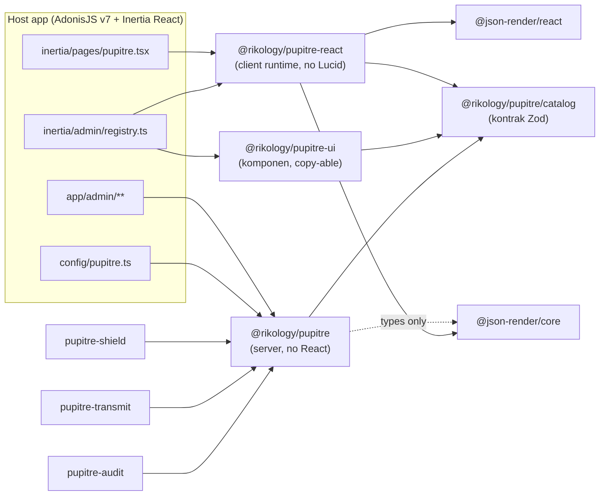
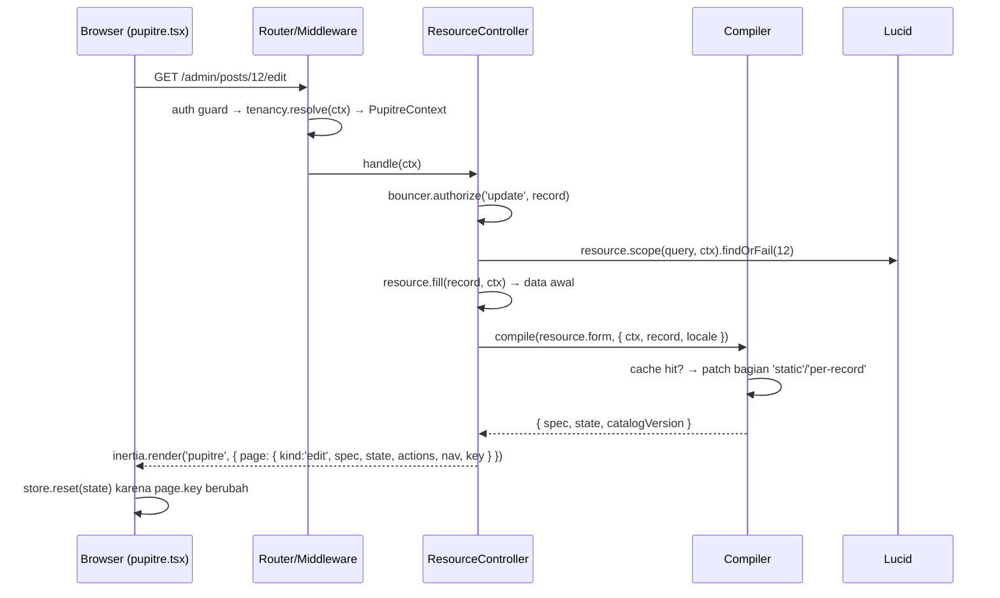

# Pupitre — Arsitektur

Turunan dari [DESIGN.md](./DESIGN.md). Dokumen ini menjelaskan *bagaimana* keputusan desain diwujudkan dalam kode: batas package, modul internal, alur request, dan invarian yang tidak boleh dilanggar.

## 1. Batas package



| Package | Boleh import | Tidak boleh import |
| --- | --- | --- |
| `pupitre` | `@adonisjs/*`, `@vinejs/vine`, `luxon`, `@json-render/core` (hanya `type`) | `react`, `@inertiajs/react`, apa pun dari `pupitre-react`/`pupitre-ui` |
| `pupitre/catalog` | `zod` saja | Semua yang lain (dipakai server + client + renderer non-React) |
| `pupitre-react` | `react`, `@inertiajs/react`, `@json-render/core`, `@json-render/react`, `zustand`, `pupitre/catalog` | `@adonisjs/*`, `lucid`, JSX komponen visual |
| `pupitre-ui` | `react`, `@base-ui/react`, `@tanstack/react-table`, `recharts`, `pupitre/catalog`, hooks dari `pupitre-react` | `@json-render/*` langsung (lewat hooks `pupitre-react`), server code |
| Plugin resmi | `pupitre` + peer-nya sendiri | `pupitre-react` (plugin menyumbang spec, bukan komponen; komponen tambahan lewat registry host) |

Batas ini ditegakkan oleh lint rule `no-restricted-imports` per workspace dan oleh `verify:exports` di CI (lihat [DEVELOPMENT.md](./DEVELOPMENT.md)).

## 2. Modul internal `@rikology/pupitre`

```
packages/pupitre/
  index.ts                     # definePanel, defineResource, definePage, defineWidget,
                               # defineRelationManager, schema, table, action(s), nav, stubsRoot, configure
  configure.ts                 # node ace add → stubs, migrasi, adonisrc hook, middleware
  providers/pupitre_provider.ts
  services/main.ts             # singleton PupitreManager
  commands/                    # pupitre:install, make:*, pupitre:inspect, pupitre:routes, pupitre:ui
  stubs/
  src/
    builder/                   # DSL murni: menghasilkan "definition" (plain object + closures)
      panel.ts  resource.ts  pages.ts (resource page builder)  page.ts (custom page)  widget.ts  relation_manager.ts
      schema/   table/   action.ts   nav.ts
    definition/                # tipe hasil builder (ResourceDefinition, FieldDefinition, ...)
    compiler/
      schema_compiler.ts       # FieldDefinition[] → Spec elements + initial state
      table_compiler.ts        # TableDefinition → TableDescriptor
      action_compiler.ts       # ActionDefinition → ActionDescriptor (per record)
      closure_lifter.ts        # closure → $cond/$template/$state, atau 'static'/'server'
      vine_compiler.ts         # FieldDefinition[] → vine.compile(schema)
      cache.ts                 # key panel:resource:page:locale:hash
    http/
      router.ts                # registrasi route group per panel, nama route
      middleware/              # pupitre_context, tenancy_resolver, share_props
      controllers/             # resource_controller, action_controller, custom_page_controller, internal_controller, auth/*
      page_props.ts            # merakit props `page` untuk Inertia
    pages/                     # custom page routes, owner resolver untuk form/options/upload
    query/
      table_query.ts           # URL query → Lucid query (sort/search/filter/group/paginate)
      search.ts                # global search
      options.ts               # opsi dinamis + relationship search
    authz/bouncer.ts           # pemetaan aksi panel → ability
    tenancy/                   # TenancyAdapter + driver default (kolom tenant_id)
    adapters/                  # interface: jobs, realtime, storage, mail, cache, tenancy, notifications, audit
    drivers/                   # implementasi atas optional peers (subpath export)
    auth/                      # login, register, reset, profile, mfa (totp), passkeys, social
    discovery/index_admin.ts   # hook adonisrc indexAdmin
    testing/                   # subpath @rikology/pupitre/testing
  catalog/                     # subpath @rikology/pupitre/catalog (Zod, tanpa dependency lain)
```

Aturan lapisan di dalam core, dari bawah ke atas: `catalog` → `definition` → `builder` → `compiler` → `query`/`authz`/`tenancy` → `http`. Lapisan bawah tidak boleh import lapisan atas. `builder` tidak boleh menyentuh `HttpContext`; semua yang butuh request terjadi di `compiler` (saat `compile(definition, ctx)`) atau `http`.

## 3. Modul internal `@rikology/pupitre-react`

```
packages/pupitre-react/src/
  page/Pupitre.tsx             # satu page Inertia; switch pada page.kind
  shell/                       # Sidebar, Topbar, TenantSwitcher, GlobalSearch, NotificationTray, Breadcrumb (dari registry)
  renderer/
    PupitreRenderer.tsx        # <StateProvider store> + <ActionProvider> + <Renderer>
    store.ts                   # Zustand store + createStoreAdapter (@json-render/core/store-utils)
    functions.ts               # $computed functions bawaan (format tanggal, angka, template)
  bridge/
    actions.ts                 # visit, reload, submitForm, openAction, runAction, evaluate, fetchOptions, upload
    inertia.ts                 # wrapper router Inertia v3: only, preserveState, deferred
    errors.ts                  # 422 → /errors/**
  hooks/                       # useField(name), useAction(name), useTable(descriptor), usePanel()
  registry/defineRegistry.ts   # wrapper defineRegistry json-render dengan catalog Pupitre
```

## 4. Alur request

### 4.1 GET halaman resource (list/create/edit/view)



### 4.2 Submit form

```mermaid
sequenceDiagram
  participant B as Browser
  participant C as ResourceController
  participant V as VineJS (compiled)
  participant L as Lucid

  B->>C: PUT /admin/posts/12 { data }
  C->>C: authorize('update')
  C->>V: validator.validate(data)
  alt invalid
    C-->>B: 422 → Inertia errors { 'items.0.sku': '...' }
    B->>B: bridge.errors → set('/errors/items/0/sku'); /data tidak disentuh
  else valid
    C->>L: trx.begin()
    C->>C: mutateBeforeSave → beforeSave → record.merge().save() → afterSave
    C->>L: trx.commit()
    C-->>B: redirect (flash) → props baru untuk page yang sama
  end
```

### 4.3 Action berbentuk form (modal)

1. Spec halaman membawa `ActionDescriptor { name, kind:'form', url, label, icon, color, enabled }`.
2. Klik → `useRunAction()` → `GET url` (`Accept: application/json`) → `ActionFormResponse { spec, state }` → `ActionModal` dirender oleh `PupitreRenderer` kedua dengan store terpisah.
3. Submit → `fetch(url, { data, ids? })` JSON dengan `X-Pupitre-Action: 1` → `ActionResult { flash, redirect?, reload?, patch?, deselect? }` / 422 / 403 (ADR-0012, WIRE_PROTOCOL §4).

### 4.4 Tabel

URL query adalah satu-satunya sumber state tabel. `useTable` → `router.reload({ only: ['data'], data: query })` → `ResourceController.list` membangun ulang query Lucid dari URL → mengembalikan prop top-level `data: { rows, meta, query }` (ADR-0011). Spec/descriptor tabel tidak ikut dikirim ulang.

## 5. Compiler

### 5.1 Input/output

```ts
compileForm(nodes: SchemaNodeDefinition[], options: CompileContext & { form: FormDescriptor; data? }): Promise<CompiledSchema>
compileInfolist(nodes: SchemaNodeDefinition[], options: CompileContext): Promise<CompiledSchema>
// CompileContext = { locale, timezone, ctx?, record?, model?, uploadUrls?, resolveFileUrl?, cache? }
// CompiledSchema = { spec: Spec, state: StateModel, catalogVersion: string }
```

### 5.2 Cache

- Key: `${panel}:${resource}:${page}:${locale}:${hash}` di mana `hash` = SHA-1 dari `definition.toJSON()` (closure di-hash dari `Function.prototype.toString()`).
- Nilai: spec + daftar *slot* yang bergantung record/ctx (`static` dari closure lifter, `fillForm`, `visible`/`can` per action).
- Per request: ambil dari cache → evaluasi slot → `applySpecStreamPatch` untuk menambal. Tidak pernah memutasi objek cache.
- Dimatikan saat `NODE_ENV=development` kalau `config.pupitre.cache.dev === false` (default) supaya edit resource langsung terlihat.

### 5.3 Closure lifting

Lihat [DESIGN.md §Compiler](./DESIGN.md#compiler-builder--spec-json-render). Keputusan tambahan:

| Hasil lift | Dipakai untuk | Cara kerja |
| --- | --- | --- |
| `expression` | `visible`, `disabled`, `label`, `helperText`, `placeholder.content` | `acorn` mem-parse `fn.toString()`; pola sederhana diterjemahkan: `get('status') === 'published'` → `{ $state: '/data/status', eq: 'published' }`, `!==`/`>`/`<`/`!`/truthiness, `&&` → `$and`, `\|\|` → `$or`, template string → `$template`, ternary → `$cond`; di dalam repeater `get('qty')` → `{ $item: 'qty' }` |
| `static` | sama | Dievaluasi per request di server dengan state awal + record; hasil literal di-patch ke salinan spec cache |
| `server` | `afterStateUpdated` | M3 (WP31): `watch` → `evaluate` → `POST /_pupitre/evaluate`. Di M1 hanya `set('x', <ekspresi terangkat>)` yang didukung (→ `watch` + `setState`); selain itu `E_PUPITRE_UNLIFTABLE_CLOSURE` saat compile |
| `computed` | `placeholder.content` aritmatika sederhana | `{ $computed: 'expr', args }` dengan **fungsi terdaftar** bawaan (`add`, `mul`, `concat`, `formatNumber`, ...), **bukan** string JS yang di-`eval` |

Keputusan: desain v0 menyebut "fungsi dikirim sebagai string di spec". Itu **tidak** dilakukan: `new Function` di client bentrok dengan CSP Shield (`script-src` tanpa `unsafe-eval`) dan membuka celah kalau spec pernah berasal dari sumber lain. Closure yang tidak bisa dipetakan ke fungsi `$computed` terdaftar jatuh ke `static` atau `server`. Lihat [ADR-0002](./adr/0002-client-first-reactivity.md).

## 6. Otorisasi dan tenancy di jalur request

Urutan middleware group panel (dipasang oleh `router.ts`):

1. Middleware host dari `.middleware([...])` — referensi middleware asli (`middleware.auth({ guards: ['web'] })` dari `#start/kernel`), bukan string, karena package tidak bisa mengimpor koleksi named middleware host.
2. `pupitre_context`: membangun `ctx.pupitre = { panel, locale, timezone, user }`.
3. `tenancy_resolver`: resolves the configured `TenancyAdapter`, confirms membership, sets `ctx.pupitre.tenant`, and request-binds the panel path in URL mode. The `@rikology/adonisjs-tenant` driver runs downstream work in `TenantService` context.
4. `share_props`: `inertia.share({ user, tenant, tenants, nav, flash, notifications })`. `nav` sudah difilter `viewAny`.

Controller selalu mengotorisasi ability tingkat resource sebelum query (`viewAny` untuk list, `create` untuk create, serta `viewAny` sebelum pencarian record); setelah record ditemukan lewat query terscope, ability record (`view`/`update`/`delete` atau custom action) diperiksa sebelum data dipakai atau dimutasi. Query selalu lewat `scopedQuery(ctx, resource)`: callback `.scope(fn)` berjalan terlebih dahulu, lalu default adapter scope; `.scope(false)` sengaja melewati tenancy untuk resource global. Ownership create diterapkan lagi setelah mutation hooks, sementara update menghapus kolom ownership dari data sebelum handler/merge agar record tidak dapat dipindahkan tenant. Policy relasi memakai policy model terkait (`viewAny`). Matriks test memeriksa semua route panel yang diklasifikasikan dan gagal bila ada route baru tanpa mapping.

## 7. Auth bawaan

Semua halaman auth adalah `definePage` internal dengan `kind: 'auth'` (tanpa shell). Mereka memakai guard panel dan tabel/kolom di [DATABASE.md](./DATABASE.md). Fitur yang menyentuh kriptografi:

| Fitur | Library | Penyimpanan |
| --- | --- | --- |
| TOTP | `otplib` | `users.mfa_secret` dienkripsi `encryption` Adonis; `users.mfa_recovery_codes` hash argon2 per kode |
| Passkeys | `@simplewebauthn/server` | tabel `pupitre_passkeys` (credential id, public key, counter, transports) |
| Reset password | token acak 32 byte, hash SHA-256 | tabel `pupitre_password_resets`, TTL 60 menit |
| Social | `@adonisjs/ally` host | kolom `users.provider`, `users.provider_id` opsional; kalau tidak ada, hanya mencocokkan email |

## 8. Invarian

- Server tidak pernah mempercayai `spec` dari client. Spec hanya mengalir server → client. Body `POST` divalidasi VineJS dari definition, bukan dari spec.
- Client tidak pernah memegang logika otorisasi: `visible`/`can` action sudah dievaluasi di server; client hanya menyembunyikan tombol dan server tetap menolak 403.
- `/data` di store hanya diubah oleh user atau `set()` dari handler; reload props Inertia memperbarui `/meta/record`, `/errors`, `/options` saja.
- `page.key` berubah ⇔ store di-reset. Key = `${panel}:${resource}:${page}:${recordId ?? ''}:${tenant ?? ''}`.
- Satu definition → satu `vine.compile()`; tidak ada validasi ad-hoc per field di controller kecuali inline edit (`PATCH column`) yang memakai sub-schema satu field dari compiler yang sama.
- Semua `dateTime` disimpan UTC, dikirim ke client sebagai ISO 8601 dengan offset, ditampilkan di timezone panel/user/komponen (urutan prioritas: komponen > user > panel > `config/app.ts`).
