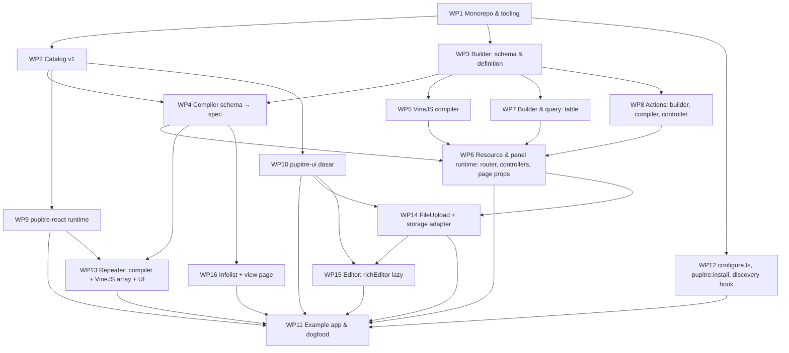

# Pupitre — Rencana Implementasi

Pemecahan milestone M0–M4 dari [DESIGN.md](./DESIGN.md) menjadi work package (WP) dengan dependensi, deliverable, dan kriteria selesai. Satu WP = satu PR atau satu rangkaian PR kecil yang bisa di-review terpisah. Estimasi tidak ditulis; urutan dan gate yang mengikat.

Prinsip pengurutan: yang paling awal adalah apa yang membuat **satu project internal bisa dogfood dengan 3 resource** (gate M1). Fitur yang tidak dibutuhkan untuk itu digeser ke belakang meskipun kecil.

## M0 — Spike

Lihat [SPIKE_M0.md](./SPIKE_M0.md). Deliverable: §7 terisi, keputusan GO/FALLBACK, jawaban Q1–Q6. Tidak ada kode yang dipertahankan dari spike kecuali catalog + registry contoh yang dipindah ke `packages/catalog/fixtures`.

## M1 — Core

Gate: satu project internal memakai Pupitre untuk ≥3 resource (list, create, edit, delete, satu custom action).

| WP | Isi | Selesai kalau |
| --- | --- | --- |
| **WP1** Monorepo & tooling | npm workspaces, `packages/{pupitre,pupitre-react,pupitre-ui}`, `apps/example`, tsdown+tsc build, eslint/prettier Adonis, Japa runner per package, CI (lint, typecheck, test, build, `verify:exports`), lint rule batas import (ARCHITECTURE §1) | `npm run build && npm test` hijau di CI untuk package kosong; `verify:exports` jalan |
| **WP2** Catalog v1 | `packages/pupitre/catalog`: schema json-render Pupitre, komponen primitif input+layout (CATALOG §2.1–2.2 minus wizard/markdown/code editor), `Form`, `ActionBar`, `DataTable`/`Repeater`/`FileUpload` descriptor types, infolist entries, actions (CATALOG §5), fungsi `$computed` bawaan, fixtures per komponen | Test Zod untuk setiap fixture; `catalogVersion` diekspor |
| **WP3** Builder schema & definition | `defineResource`, `schema.*` untuk komponen WP2, `.required/.maxLength/...`, closure props (`visible`, `disabled`, `label`), `live()`, `afterStateUpdated`, `definition.toJSON()` deterministik untuk hash | Snapshot `toJSON()` untuk resource contoh; type test: `s.text('nope')` error untuk kolom yang tidak ada di model |
| **WP4** Compiler schema → spec | `schema_compiler`, `closure_lifter` (expression/static/server, tanpa string eval), state awal dari record, `/errors` binding, cache key + patch slot, `validateSpec` di dev | Snapshot spec untuk tiap komponen; test closure lifter: tabel kasus (eq/neq/and/or/template/gagal→static); test cache: dua request record berbeda → satu compile |
| **WP5** VineJS compiler | rule → vine, `unique` dengan Lucid, repeater → `vine.array(vine.object)`, `dehydratedWhenHidden`, pesan error path `items.0.sku`, inline edit sub-schema | Test per rule; test path error nested; satu `vine.compile` per definition (spy) |
| **WP6** Resource & panel runtime | `definePanel` minimal (path, guard, middleware, resources), `router.ts` + nama route + Tuyau, middleware `pupitre_context`/`share_props`, `ResourceController` (list/create/store/edit/update/view/destroy), hooks (`fill`, `mutateBefore*`, `before/after*`), transaksi, flash, `page_props.ts`, Bouncer mapping default (`<Model>Policy`, default allow + warning) | Test fungsional Japa per route (200/302/403/404/422); test hooks urutan; `urlFor('admin.posts.edit')` type-check di example |
| **WP7** Table | builder `table.*` (kolom text/badge/icon/image/toggle/select, filters select/ternary/dateRange/custom, tabs, defaultSort, paginated, searchDebounce, emptyState), `table_query.ts` (URL → Lucid: sort/search/filter/tab/paginate, relasi `author.name` → preload/whereHas), `table_compiler` → descriptor, `TableData` dengan cell terformat, `PATCH column`, bulk `ids[]` | Test query builder dengan SQLite: tiap param; test keamanan: sort kolom non-sortable → 400, filter tak dikenal diabaikan; test format tanggal timezone |
| **WP8** Actions | `action()` builder, `actions.create/edit/view/delete`, `kind` inference, `ActionController` (GET spec / POST handle), `requiresConfirmation`, `form()`+`fillForm`, `notify`, `redirect`/`refresh`, `can()`, `visible()` per record, bulk | Test: tiap kind end-to-end; 403 kalau `can` gagal walau client kirim; respons `{ patch }` |
| **WP9** pupitre-react runtime | `Pupitre.tsx`, `PupitreRenderer` + store Zustand (reset by key), bridge (visit/reload/submitForm/openAction/runAction/evaluate/fetchOptions), 422 mapping, `ActionModal`, `defineRegistry` wrapper, `usePanel`, shell minimal (sidebar dari `nav`, topbar, breadcrumb, toast) | Test React (happy-dom): store tidak reset pada reload props; 422 → `/errors`; openAction form → modal → submit; Playwright di example |
| **WP10** pupitre-ui dasar | Komponen WP2 di atas shadcn Base UI; `DataTable` (TanStack untuk render + column state), `Form`, `ActionBar`, shell | Story/fixture render test per komponen; `assertRegistryComplete` hijau |
| **WP11** Example app & dogfood | `apps/example`: Post (repeater `items`, cover upload, body richEditor, view page)/Category/User dengan policy, panel `admin`; Playwright smoke: CRUD + action + filter + 422 + repeater add/remove + upload; pindahkan 3 resource project internal | Smoke hijau di CI; project internal memakai `@rikology/pupitre@0.1.x` dari npm (publish pre-release) |
| **WP12** Install & discovery | `configure.ts` (stubs: config, `pupitre.tsx`, `registry.ts`, panel admin, middleware), `pupitre:install` idempotent, hook `indexAdmin` di `adonisrc.ts` → `.adonisjs/server/admin.ts` (gitignored), `pupitre:routes` | Test configure dengan `IgnitorFactory`; `indexAdmin` snapshot barrel; run dua kali tanpa perubahan |
| **WP13** Repeater | `s.repeater().schema([...]).minItems/maxItems/reorderable/collapsible/defaultItems`; compiler → elemen `Repeater` + `repeat.statePath` + `$bindItem` + template children; error per item sesuai jawaban SPIKE Q1; VineJS `vine.array(vine.object)`; UI add/remove/reorder/collapse; nested repeater | Snapshot spec nested; test 422 `items.1.sku` → error di item kedua saja; Playwright: add/remove tanpa kehilangan ketikan item lain. **Prasyarat: SPIKE K1 lulus** |
| **WP14** FileUpload | `s.fileUpload().disk/image/maxSize/multiple/accept/directory/visibility/reorderable`; `storage` adapter (Flydrive disk host); `POST/DELETE /_pupitre/upload` (MIME sniff, ukuran, ability `create/update`); nilai state = key; preview URL signed/public sesuai visibility; orphan cleanup saat record disimpan tanpa key lama | Test upload ditolak MIME palsu & oversize; test key tersimpan di record; Playwright upload gambar → preview. Image editor **tidak** termasuk (M3) |
| **WP15** RichEditor | `s.richEditor().toolbar([...])` Tiptap, `React.lazy`, upload gambar inline via `/_pupitre/upload`, sanitasi HTML server-side saat save (allowlist tag/attr) | Test sanitasi (script/onerror dibuang); bundle editor tidak masuk chunk utama (`vite build` manifest) |
| **WP16** Infolist & view page | `.infolist((s) => s.entries([...]))`, entries `textEntry/iconEntry/imageEntry/colorEntry/keyValueEntry/repeatableEntry/codeEntry/badgeEntry`, layout sama dengan form, nilai terformat server (timezone, money), `pages.view()` dengan header actions | Snapshot spec view page; test format nilai; Playwright view page |

Di luar scope M1 meskipun ada di catalog: `wizard`, `builder`, `markdownEditor`, `codeEditor`, image editor upload. Penomoran WP M2 ke atas digeser mengikuti.

## M2 — Panel

Gate: project internal kedua pindah ke Pupitre.

| WP | Isi | Selesai kalau |
| --- | --- | --- |
| **WP17** Auth dasar | login, logout, forgot/reset (tabel `pupitre_password_resets`, mail adapter), register opsional, email verification opsional, profile (nama/email/password/avatar via storage adapter), `.login(false)` untuk host yang punya auth | Test fungsional tiap alur; rate limit login via `@adonisjs/limiter` kalau terpasang |
| **WP18** Navigation & panel lengkap | `nav.group/item`, sort, badge closure, collapsible, `viewAny` filter, brand/theme CSS vars, multi panel (`make:panel`), `.domain()`, `.userMenu([...])`, `page.key` tenant-aware | Snapshot `nav` untuk user dengan izin berbeda |
| **WP19** Bouncer mapping lengkap | Tabel DESIGN §Otorisasi; `pupitre:inspect` melaporkan policy hilang; relation/nested memakai policy model relasi | Test matrix ability × route |
| **WP20** Tenancy | `TenancyAdapter`, driver default kolom `tenant_id`, driver `@rikology/adonisjs-tenant` (mode `url` PathResolver, mode `implicit`), `tenancy_resolver` middleware, switcher, `.scope(false)`, auto-fill ownership | Test: cross-tenant read → 404, create mengisi `tenant_id`, mode url vs implicit |
| **WP21** Notifications | flash → toast (sudah ada) + `notifications` adapter: driver `@rikology/adonisjs-notifications`, `NotificationTray`, polling `only`, `markRead` | Test driver dengan tabel notifications peer; tanpa driver → hanya flash, tanpa error |
| **WP22** Global search | `globallySearchable`, `GET /_pupitre/search` paralel, cmdk UI, keybinding | Test batas 5/resource dan scoping tenant/policy |
| **WP23** Custom page | `definePage` (path, form, fill/save, actions, `component()` escape hatch), `make:page` | Example: Settings page |
| **WP24** `make:resource` | Introspeksi model Lucid (kolom, tipe, enum meta, relasi) → stub field/column; `--from-migration` | Snapshot stub untuk model fixture |
| **WP25** Options dinamis | `options(closure)`, `relationship().searchable()`, `GET /_pupitre/options`, `preload()`, `createOption` modal, `suffixAction`/`prefixAction` | Test debounce+paging di UI; policy `viewAny` model relasi |

## M3 — Parity

Gate: [FILAMENT_PARITY.md](./FILAMENT_PARITY.md) semua baris "v1" ✅.

| WP | Isi |
| --- | --- |
| **WP26** Builder (block editor) & Wizard (schema + modal), `markdownEditor`, `codeEditor` (CodeMirror, lazy), image editor untuk `fileUpload` |
| **WP27** Widgets (stats/chart/table, dashboard, deferred props, poll, filters) + `make:widget` |
| **WP28** Relation managers (hasMany/manyToMany, attach/detach/associate, prefix query) + nested resource (`parent()`, breadcrumb) + `make:relation-manager`; `pages.list().modals()` (simple resource) |
| **WP29** Table lanjutan: grouping + summaries, inline edit (`toggle`/`select`/`textInput` column), reorderable, poll, column toggles (localStorage), grid layout, soft deletes (`restore`/`forceDelete`, filter trashed), `t.count()`, `.deferFilters()`, search per kolom |
| **WP30** Import/Export CSV: sinkron dengan batas baris; `jobs` adapter + driver `@adonisjs/queue`; tabel `pupitre_exports` untuk progress; download via storage adapter |
| **WP31** `live({ server: true })` + `/_pupitre/evaluate`, `pupitre:inspect` lengkap |
| **WP32** MFA TOTP + recovery codes; passkeys (`pupitre_passkeys`); social login via Ally (kolom `provider`/`provider_id` opsional); `.deepLinkable()`; `action.rateLimit()` via `@adonisjs/limiter` |
| **WP33** Theme per panel (`app/admin/themes/<panel>.ts` → CSS vars: font, density, sidebar style, content width) |
| **WP34** Testing helpers `@rikology/pupitre/testing` (Japa) + fixture Playwright `pupitre-ui/testing` |
| **WP35** Timezone end-to-end: panel/user/komponen override, parse input di timezone, DST test |

## M4 — Ecosystem

| WP | Isi |
| --- | --- |
| **WP36** Plugin API stabil: `definePlugin({ register(panel), boot(app), resources, pages, middleware, navigation })`, `make:plugin` + `create-pupitre-plugin` |
| **WP37** `pupitre-shield`: tabel roles/permissions, UI resource, policy generik `posts.update`, `superAdminRole` |
| **WP38** `pupitre-audit`: adapter `audit` + driver `adonisjs-audit-trail`, timeline di view/edit page, resource "Activity" |
| **WP39** `pupitre-transmit`: realtime adapter atas `@adonisjs/transmit`, event `pupitre:notification`, table push |
| **WP40** shadcn registry publik (`registry.json`, build dari sumber `pupitre-ui`, CI diff check, `pupitre.rikology.com/r/*`) + `pupitre:ui add` |
| **WP41** Docs site (`pupitre.rikology.com`), panduan migrasi dari Filament (padanan API), changelog |
| **WP42** Rilis 1.0: audit keamanan (CSRF semua POST, CSP tanpa unsafe-eval, upload MIME sniff, rate limit auth), audit a11y komponen, perf budget bundle |

## Definisi "selesai" untuk setiap WP

1. Kode + test sesuai [TESTING.md](./TESTING.md); CI hijau.
2. Dokumen yang terdampak diperbarui (WIRE_PROTOCOL, CATALOG, DATABASE, FILAMENT_PARITY).
3. Example app menunjukkan fitur (kalau ada UI).
4. Tidak ada `TODO`/stub yang dikirim ke npm; fitur yang belum ada tidak punya builder method (lebih baik error TypeScript daripada no-op).
5. Changeset/CHANGELOG entry.

## Ketergantungan eksternal yang perlu dipantau

| Dependency | Versi saat ini | Risiko | Tindakan |
| --- | --- | --- | --- |
| `@json-render/core`/`react` | 0.21.0 (2026‑09‑18) | 0.x, API `experimental_*` berubah | Pin exact; renovate manual; test spike dijadikan regression suite |
| `@adonisjs/inertia` 5 / `@inertiajs/react` 3 | 5.0.1 / 3.9.1 (2026‑10‑10); `@adonisjs/inertia` 4 hanya untuk Inertia v2 | partial reload `only` hanya menyaring prop top-level | Data tabel = prop top-level `data` (ADR-0011); test `only: ['data']` di WP6 |
| shadcn + Base UI | `@base-ui/react` 1.9 (paket lama `@base-ui-components/react` berhenti di 1.0.0-rc) | API Base UI 1.x | Komponen UI dibungkus adaptor tipis (`pupitre-ui/src/primitives`) |
| `@tanstack/react-table` | 8.21.3 (v9 sudah rilis) | v9 mengganti API | Tetap v8 di M1; evaluasi v9 setelah 1.0 |
| `@playwright/experimental-ct-react` | 1.62.1 (dipasangkan dengan `@playwright/test` 1.62.1) | experimental; transform JSX CT menduplikasi import campuran | Test CT hanya mengimpor komponen story (`tests/ct/stories`) |
| `@adonisjs/queue` | 0.6.x | breaking minor | Driver dipin minor; adapter interface stabil |
| `@rikology/adonisjs-tenant`, `-notifications`, `-audit-trail` | milik sendiri | perubahan ikut kebutuhan Pupitre | Driver di subpath, optional peer, test terhadap versi yang dipin |
